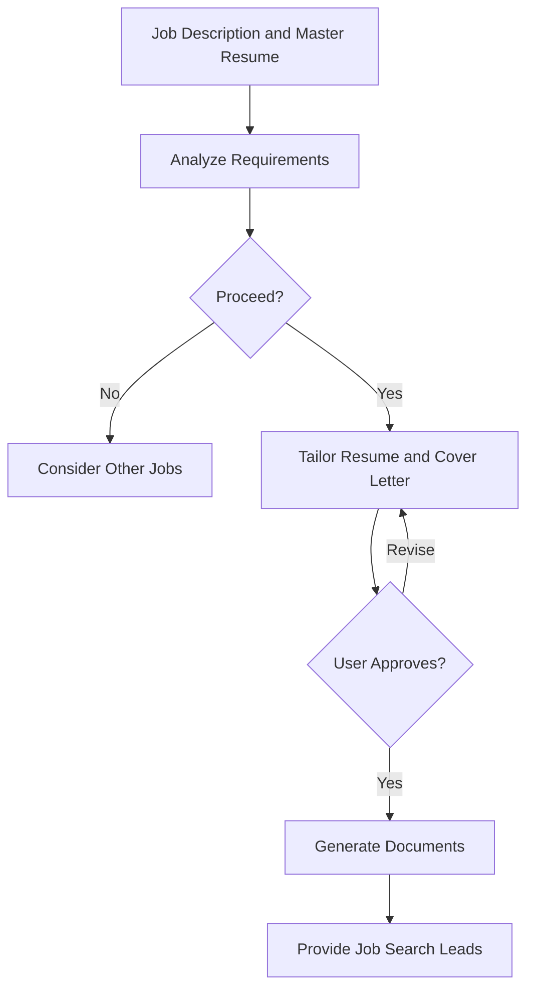

# AI-Powered Résumé Optimization Workflow

### Custom Google Gemini Gem | AI Workflow Design & Prompt Engineering

## Project Overview

This project documents the design and iterative refinement of a custom Google Gemini Gem developed to streamline résumé tailoring, evaluate job opportunities, and support informed application decisions.

The workflow combines structured prompt engineering, conditional decision rules, contextual analysis, accuracy safeguards, and human approval checkpoints.

Rather than relying on a single generic résumé-writing prompt, the Gem follows a defined four-stage process intended to produce accurate, role-specific application materials while reducing repetitive manual work.

**Platform:** Google Gemini Gems  
**Primary Focus:** AI Workflow Design, Prompt Engineering, and Quality Assurance  
**Development Approach:** Iterative testing, troubleshooting, and instruction refinement

## Problem Statement

Tailoring a résumé for individual job postings can be time-consuming, particularly when applications require different terminology, competencies, and formatting conventions.

A generic AI résumé writer may overlook relevant qualifications, introduce unsupported claims, or produce materials that require substantial manual correction.

This project was designed to address those challenges through a reusable, controlled AI workflow.

## Workflow Architecture

### Stage 1: Job Analysis and Application Strategy

The Gem is instructed to:

- Analyze the target job description and identify relevant skills, responsibilities, and qualifications.
- Compare job requirements against an established baseline résumé.
- Research the employer's application platform when information is available.
- Identify potential warning signs associated with questionable or inactive job postings.
- Estimate keyword alignment and recommend opportunities that better match the candidate's experience when appropriate.
- Present proposed résumé changes with explanations.

### Stage 2: Content Development and Human Review

The workflow generates tailored résumé and cover-letter previews.

It is designed to explain changes in language, positioning, and emphasis while preserving the candidate's verified experience.

An explicit user-approval checkpoint is required before proceeding to final document generation.

### Stage 3: Document Generation

Following approval, the workflow requests downloadable application documents in standardized formats.

Defined output requirements include:

- Microsoft Word résumé (.docx)
- PDF résumé (.pdf)
- Microsoft Word cover letter (.docx)
- Standardized filenames
- A maximum two-page résumé format

Document generation is a configured workflow requirement; successful delivery depends on the capabilities available in the Gemini environment.

### Stage 4: Job Search Support

After document preparation, the workflow is instructed to provide relevant job-search links based on the candidate's professional background and location preferences.

The Gem also serves as a conversational resource for researching employers, job descriptions, and broader job-market questions.

## Prompt Engineering Techniques

### Structured Task Decomposition

The overall objective is divided into sequential stages with defined inputs, outputs, and decision points.

### Source-of-Truth Constraints

A baseline résumé serves as the authoritative reference for employment history, professional qualifications, accomplishments, and credentials.

The workflow explicitly prohibits inventing experience or performance metrics.

### Conditional Decision Logic

The instructions establish a target for estimated keyword alignment and direct the Gem to recommend moving on when an opportunity cannot be matched truthfully.

This is a user-defined screening heuristic, not a verified ATS score.

### Human-in-the-Loop Validation

The user reviews proposed content before final documents are generated, allowing corrections and adjustments.

### Output Standardization

The workflow specifies document types, formatting expectations, filenames, and required deliverables to promote consistency.

## Real-World Case Study: Workforce Management Real Time Analyst

A test case involved tailoring a professional workforce management résumé for a Workforce Management Real Time Analyst position at Devoted Health.

The job description emphasized real-time queue operations, staffing adjustments, intraday performance monitoring, standard operating procedures, cross-functional collaboration, and spreadsheet analysis.

### Observed Results

The generated résumé successfully emphasized many of the position's central requirements, including:

- Real-time workforce and queue management
- Intraday staffing analysis and schedule adherence
- Forecasting and capacity planning
- Service-level performance
- Operational reporting
- Cross-functional collaboration
- Standard operating procedures

The output also placed SQL training under professional development rather than presenting SQL as a primary technical competency, consistent with a specific workflow guardrail.

### Identified Limitations

Review of the generated output revealed several areas for improvement:

- The résumé headline did not exactly match the advertised job title.
- Minor spacing and punctuation errors remained in the finished document.
- Some experience claims and technical proficiencies required source verification.
- Several secondary job requirements were not directly demonstrated.

This evaluation reinforced the importance of human review and independent quality assurance.

**Privacy note:** The original application materials are not published in this repository because they contain personal information.

## Testing and Iterative Development

The Gem was developed through repeated cycles of instruction design, output review, issue identification, and refinement.

When a problem was identified, the workflow instructions were revised and subsequent outputs evaluated to determine whether the change addressed the issue.

Successful adjustments were incorporated into the standing workflow instructions.

This approach emphasized repeatability, consistency, accuracy, and practical usability rather than relying on a single prompt.

## Limitations

- Estimated ATS alignment is an internal heuristic and does not represent a verified score from an employer's applicant tracking system.
- No workflow can guarantee that an application will pass automated screening or reach a recruiter.
- Ghost-job warning signs are indicators for further investigation, not proof that a posting is inactive or fraudulent.
- Availability and accuracy of employer research depend on access to current sources.
- Generated documents require proofreading and verification against the baseline résumé.
- Platform-specific tool availability can affect document generation and other automated steps.

## Skills Demonstrated

- Prompt Engineering
- AI Workflow Design
- Generative AI
- Process Automation Design
- Requirements Analysis
- Conditional Decision Logic
- Human-in-the-Loop Review
- AI Output Evaluation
- Quality Assurance
- Iterative Process Improvement
- Technical Documentation

## Project Outcomes

This project produced a reusable, multi-stage Gemini Gem configuration designed to support résumé tailoring and application decisions.

The documented case study demonstrates role-specific content generation, adherence to selected custom instructions, and opportunities for improving the workflow through quality assurance.

The project illustrates how generative AI can be structured into a practical business process with clearly defined expectations, human oversight, and continuous improvement.

## Future Improvements

Potential enhancements include:

- A standardized requirements-coverage scoring rubric
- More explicit definitions for estimated keyword-alignment scores
- Automated checks for unsupported accomplishments and technical skills
- Consistent proofreading and formatting validation
- Expanded testing using fictional candidate profiles
- Documented test cases and version history

---

**Project Type:** Independent AI Workflow Design  
**Platform:** Google Gemini  
**Purpose:** Demonstrate structured prompt engineering, workflow development, and practical AI quality assurance.

*This project is independently developed and is not affiliated with or endorsed by Google, Gemini, Devoted Health, or any employer mentioned in the case study.*
